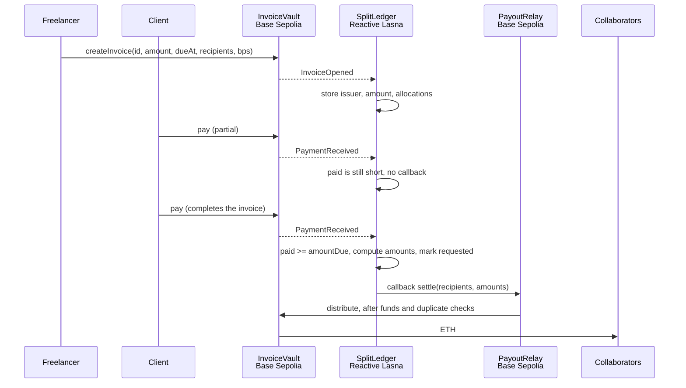

# Keeperless invoice splits

A freelancer sets a revenue split once. A client pays the invoice, in one transfer or several. When the invoice is fully paid, collaborators are paid automatically. No keeper, no backend, and no agent has to stay online.

This is an entry for the [Reactive Omni Buildathon](https://dorahacks.io/hackathon/reactive-omni-buildathon/detail), track **Set It and Forget It**. Deadline: **5 December 2026, 20:00 UTC**.

## Problem

Splitting a paid invoice is still a chore. The client pays one address, then somebody has to notice, do the arithmetic, and send each collaborator their share. A bot can do that, until the laptop sleeps, the key expires, or the process crashes. The people owed money wait on a process that is not part of the agreement.

The agreement can live on-chain instead. The invoice contract holds the client's ETH. A reactive contract on Reactive Omni remembers the invoice, the partial payments, and the agreed percentages. When the paid total reaches the amount due, it asks a destination contract to pay the split. That request is a normal cross-chain callback. Nothing off-chain has to wake up.

## Track and networks

**Set It and Forget It** is for personal automations on any chain Reactive supports. The track brief allows Reactive mainnet or the Lasna testnet. This submission uses **testnets only**.

| Role | Chain | Why |
| --- | --- | --- |
| Origin and escrow | Base Sepolia (chain id `84532`) | Reactive lists it as an origin and a destination. Blocks are ~200ms, so every deadline below is a timestamp. |
| Reactive ledger | Reactive Lasna (chain id `5318007`) | Omni, CometBFT, ~1s blocks, instant finality. System contract `0x8888888888888888888888888888888888888888`. |
| Destination | Base Sepolia, a separate payout relay | The callback lands here and the relay instructs the vault to pay. Invoice ETH never has to be bridged. |

Unichain Sepolia (chain id `1301`, callback proxy `0x775c9B990ADe401060B78D0e98684eEf8d2466C1`) is also a supported testnet. It is not the destination, because a callback cannot carry the ETH the client already paid on Base. Paying collaborators from that same escrow is the useful behavior: the money that arrived is the money that leaves.

Callback proxy on Base Sepolia: `0x476F44b11F5C942c58f4c8E3d0300E5710743585`.

## Architecture



Three contracts, three jobs:

1. **InvoiceVault** (Base Sepolia) receives `createInvoice`, `pay`, and timestamp-based `refund`. It emits the events the ledger subscribes to, and it is the only contract that holds client funds.
2. **SplitLedger** (Lasna) is the reactive contract. `react()` is called by the system contract when a subscribed log appears. It keeps the invoice book and, once, asks for a callback. It does not trust the destination to remember who was owed what.
3. **PayoutRelay** (Base Sepolia) is the callback recipient. It authenticates the caller (callback proxy) and the reactive sender, checks the vault's escrow, and calls `distribute`. Its own balance is only the gas reserve the callback proxy bills. A fee cannot spend a client's invoice.

The web UI is a watcher and a wallet. It does not run the split. Closing the tab does not stop a fully paid invoice from settling.

## How the reactive contract works

`SplitLedger` inherits `AbstractReactive` from [reactive-lib-omni](https://github.com/Reactive-Network/reactive-lib-omni) (commit `3ade0dcf1d27e67e5783ef807e73a1b9e0c0cce8`). The system contract is `0x8888888888888888888888888888888888888888`. `react` is `onlySystem`.

After the vault address is known, the owner calls `watch(vault)`. That subscribes to three events from that contract on Base Sepolia, with `REACTIVE_IGNORE` for topics 1–3:

| Event | What `react` stores |
| --- | --- |
| `InvoiceOpened(bytes32,address,uint256,uint64,address[],uint16[])` | Issuer, amount due, due timestamp, and up to eight recipients with basis points. The points must sum to 10,000. |
| `PaymentReceived(bytes32,address,uint256,uint256,uint256)` | Raises `paid` to the escrow total reported by the vault. |
| `PaymentRefunded(bytes32,address,uint256,uint256,uint256)` | Lowers `paid` when a payer reclaims after the due timestamp, and only if a payout was not already requested. |

Logs are deduplicated by `(chainId, txHash, logIndex)`. A payment that arrives before its `InvoiceOpened` is buffered and applied when the invoice is configured. Unknown topic0 values return without reverting, so a stray log is not billed as a revert.

When `configured && paid >= amountDue && !payoutRequested`, the ledger:

- computes `amount = amountDue * bps / 10000` for each recipient
- gives any rounding dust to the first recipient, so the amounts sum to `amountDue` and not to a later overpayment
- sets `payoutRequested` before the external call
- calls `SYSTEM.requestCallbackV_1_0` with destination chain Base Sepolia, recipient `PayoutRelay`, and `settle(address,bytes32,address[],uint256[])`
- passes `address(0)` as the first argument, which the network replaces with this contract's address

Overpayment stays in the vault. The issuer withdraws it after settlement. Underpayment never requests a callback.

`retrySettle` is owner-only, for the case where the destination skipped or reverted (empty reserve, recipient rejected the transfer). The relay treats an already settled invoice as a no-op, so a retry cannot pay twice. The happy path never needs this function, and it does not need a keeper.

## Destination checks

`PayoutRelay.settle` is `onlyServiceProvider` and `onlyCallbackSender`. It refuses to ask the vault for a payout when:

- the invoice is already settled (`SplitSkipped("duplicate")`)
- the requested total is zero, larger than that invoice's escrow, or larger than the vault's balance (`SplitSkipped("funds")`)

`InvoiceVault.distribute` is callable only by the relay, and the relay address can be set once. It marks the invoice settled before any transfer. A recipient that rejects the ETH does not unwind everyone else's payment: that share becomes claimable by the recipient. A second `distribute` returns immediately.

Refunds use `block.timestamp` against `dueAt`. There is no block-number timer. `dueAt == 0` means "no deadline": late payments are still accepted, and refunds are not. After a deadline, `pay` reverts once `block.timestamp > dueAt`, and each payer can `refund` their own contribution while the invoice is still short of `amountDue`. A fully funded invoice cannot be refunded out from under the callback.

## UI

The app in `web/` is a new interface built for this submission. It is styled after the glowing arcs in [Flowlight](https://github.com/ayinmodeolarewaju-bot/hermes-flowlight) (dark field, token-colored curves, particles moving in the direction of value). Flowlight is a read-only Hermes plugin and is not part of this repo. The canvas, the invoice form, and the contract reads are new.

What you can do:

- connect a Base Sepolia wallet
- create an invoice with recipients and percentages
- pay part of it, then the rest
- watch payment, reactive, and payout arcs as the logs land
- open the origin transaction, the Lasna reactive transaction, and the callback transaction

Public RPCs are used from the browser (`https://sepolia.base.org`, `https://lasna-rpc.rnk.dev/`). There is no API server.

## Deployed addresses

Filled in after deployment and checked in as `deployments/addresses.json`.

| Contract | Chain | Address |
| --- | --- | --- |
| InvoiceVault | Base Sepolia | pending |
| PayoutRelay | Base Sepolia | pending |
| SplitLedger | Reactive Lasna | pending |
| Deployer | both | `0xDBbEAdC24f292c067D35a70278f62d09c965A0Ac` |

A full loop (origin event, reactive transaction, callback) is recorded in `deployments/loop.json` when the demo payment settles.

## Setup

Requirements: [Foundry](https://book.getfoundry.sh/), Node 22, and a Base Sepolia wallet. Do not put a private key in the repo, in `web/`, or in a command that gets committed. The deploy script reads a key file from outside the tree (`DEPLOYER_KEY_FILE`, default `$HOME/.config/flowlight-split/deployer.key`).

```bash
git submodule update --init --recursive
forge test

cd web
npm install
npm run dev
```

`forge test` does not need a network. It etches a mock system contract at the Omni system address and walks a partial payment, a completing payment, a duplicate log, a duplicate callback, a short-funds skip, a timestamp refund, and a late payment rejection.

### Funds

Testnet only.

- Base Sepolia ETH for deployment, the callback reserve, and the invoice itself. One public drip that did not ask for a captcha: `POST https://www.vibekast.xyz/api/v2/faucet` with `{"wallet":"0x..."}`.
- Lasna lREACT. The Reactive faucet pays 100 lREACT per 1 ETH sent to the Base Sepolia faucet contract `0x2afaFD298b23b62760711756088F75B7409f5967` (`request(address)`), max 5 ETH per transaction. The same key then spends lREACT on Lasna.

Deploy and run a loop:

```bash
export DEPLOYER_KEY_FILE="$HOME/.config/flowlight-split/deployer.key"
script/deploy.sh
script/loop.sh
```

`deploy.sh` deploys `SplitLedger` on Lasna, `InvoiceVault` and `PayoutRelay` on Base Sepolia, calls `watch` and `setDestination`, and deposits a callback reserve through the Base Sepolia proxy. `loop.sh` creates an invoice, pays it in two transactions, and waits until `SplitSettled` is logged.

## Demo script (about two minutes)

1. **0:00** — "This invoice pays my collaborators when the client finishes paying. I do not run a bot."
2. **0:15** — Show the three nodes: the vault on Base Sepolia, the ledger on Reactive Lasna, the people on the split. Mention the due date is a timestamp.
3. **0:30** — Create an invoice. 50% to the freelancer, 30% and 20% to two collaborators. Amount small, testnet ETH only.
4. **0:50** — Pay half. A cyan arc runs from the payer to the vault. The ledger's stored `paid` moves. No payout arcs. "It is not fully paid, so Reactive does nothing outbound."
5. **1:10** — Pay the rest. The arc thickens. A violet arc runs into the Reactive node, then green arcs fan out to the two collaborators and the freelancer's share.
6. **1:35** — Point at the three hashes: the completing `pay` on Base, the `react` transaction on Lasna, and the callback that emitted `SplitSettled`. Refresh the recipient balances.
7. **1:50** — Close the laptop line: "The tab can close before the second payment. The contracts still settle." End on the repo and the track name.

## Judging map

- **Execution.** The loop is an origin log, a reactive transaction that calls `requestCallbackV_1_0`, and a callback transaction. Hashes live in `deployments/loop.json`.
- **Integration.** The reactive contract is the book of record: partial payments, refunds, allocation math, dust, deduplication, and the decision to pay. The relay only checks funds and duplicates, then moves ETH.
- **Usefulness.** One agreement, many payments, payout while the author is offline.
- **Craft.** Foundry tests, this note, and a UI that shows the same transactions a judge can open in the explorers.

## Explorers

- Base Sepolia: `https://sepolia.basescan.org`
- Reactive Lasna: `https://lasna.reactscan.net`

## License

The contracts and UI in this repository are MIT. `lib/reactive-lib-omni` stays under its upstream license.
